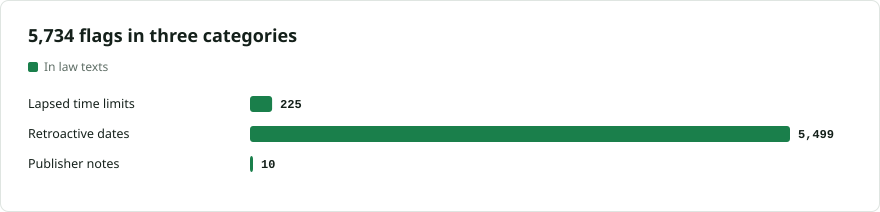

# Vulnerabilities in Philippine law

<picture>
<source media="(prefers-color-scheme: dark)" srcset="img/flags-by-category-dark.svg">

</picture>

The vulnerability detectors from [lexifina/global-law](https://github.com/lexifina/global-law/tree/main/vulnerabilities) look for mechanical mistakes in legislation: a rule applying "until" a date that has passed, a provision repealed before its replacement took effect, two amendments to the same provision on the same day, an amount changed in one place but not in another, a law in force before it was published. global-law's published list (9 November 2026) did not cover the Philippines, so this is a run over this repository only, as it stood at commit [`7472386`](https://github.com/lexifina/philippines-law/commit/7472386edbafc97d3c94ba1f304c2c39dd58c6e9) on 16 November 2026: the 1987 Constitution and 18,392 laws, each as made, in one version, from Act No. 1 (in force 12 September 1900) to Republic Act No. 12322 (21 August 2026).

**In short:** the detectors raised 5,734 flags. A language model reviewed 80 of them, arguing each one for and against; 13 survived, and none is a mistake in Philippine law when checked by hand. Seven are executive orders of 1986 that took effect "immediately" or "upon its approval" and were published weeks or months later; this repository dates them by their approval, as it dates every law approved before 29 December 1986 that takes effect on approval. Four are orders that fix their own day before the publication on record: Executive Order No. 821 (2009), on maximum drug retail prices, "shall immediately be published in at least two (2) newspapers of general circulation and shall take effect on August 15, 2009", and the record holds a publication of 21 September 2009. Two are temporary rules whose time has passed: Republic Act No. 7439 suspended inconsistent laws "until June 30, 1994" and itself ceased "to have any effect after June 30, 1994". Because this repository holds each law as made, in one version, the detectors that compare one version of a provision with the next have nothing to compare, and 5,499 of the flags are retroactive dates: laws dated in force on their approval, before the publication the record holds, 5,490 of them before 1987. The model does not review publisher notes; the 10 here are law text ("the first two paragraphs of this article"). Before a fix to the detectors' scripts, the same run also raised 14 references to repealed placeholders and 1 dead fine, all misreadings ([EDGE-CASES.md](EDGE-CASES.md)). Reading the flags showed two problems in how this repository files some laws (below). Later, this will be formalised in Lean, similar to our work on [the US tax code](https://lexifina.com/blog/formalizing-the-us-tax-code) and [US case law](https://lexifina.com/blog/formalizing-all-us-case-law-in-lean).

A flag is a prompt to look, not legal advice, and nothing here has been tested in court.

## Flags by category

| Category | What it looks for | Flags | In law texts | Reviewed | Survived review |
| --- | --- | ---: | ---: | ---: | ---: |
| Lapsed time limits | A rule that applies "until" a date that has passed | 225 | 225 | 40 | 2 |
| Retroactive or pre-publication dates | A law in force before it was published | 5,499 | 5,499 | 40 | 11 |
| Publisher notes | Notes that an amendment could not be carried out, or a "(sic)" | 10 | 10 | 0 | 0 |

"In law texts" counts all the law this repository holds: the 1987 Constitution (`constitution/`), Acts of the Philippine Commission and Legislature (`act/`), Commonwealth Acts (`ca/`), Republic Acts (`ra/`), Presidential Decrees (`pd/`), Batas Pambansa (`bp/`) and Executive Orders (`eo/`), one folder per law with a file per section or article (`pd/1974/442/art-001.md` is Article 1 of the Labor Code). The other files are each law's `README.md` (a list of its provisions), the root files (`README.md`, `REPRODUCE.md`, the licence, `jurisdiction.json`), `data/` and `tools/`; none has a flag. The history has 18,393 laws, each in one commit: 15,260 marked `Kind: law` (Republic Acts, Acts, Batas Pambansa, Commonwealth Acts), 3,132 `Kind: decree` (Executive Orders and Presidential Decrees) and the Constitution (`Kind: referendum`). No provision changes after the commit that adds it, so repeal gaps, same-day conflicts, empty periods, stale amounts and references to deleted provisions have nothing to read, and every lapsed time limit is in a law's text as made, whatever later laws did to it. The detectors read English dates ("June 30, 1994", "31 December 2025"). The peso is the current currency; Acts from 1900 to 1907 that count in "Mexican currency" are law held as made, not amounts left behind, so they are not flagged.

*Edge cases: the 13 flags that survived the review, and what the other flags are, in [EDGE-CASES.md](EDGE-CASES.md).*

## Problems found in this repository

- **960 laws numbered 1600 to 2029 are filed as if their number were a year:** since every act moved to `<kind>/<year>/<number>/` on 10 November 2026 ([the move](https://github.com/lexifina/philippines-law/commit/7cb40a25ec3b398ea931e23d5eadf1b3fa98a525)), each Act, Presidential Decree and Republic Act with a number from 1600 to 2029 is in `act/<number>/<kind>/`: Republic Act No. 1789 (1957) is in [`act/1789/ra/`](https://github.com/lexifina/philippines-law/tree/7472386edbafc97d3c94ba1f304c2c39dd58c6e9/act/1789/ra), not `ra/1957/1789/`, and Presidential Decree No. 1650 in `act/1650/pd/`. `data/paths.json` maps them so (`"ra-1789": "act/1789/ra"`): 243 Acts, 305 Presidential Decrees and 412 Republic Acts in 427 folders of `act/`, while Republic Act No. 2030 is in `ra/1957/2030/` and Act No. 1599 in `act/1907/1599/`. The texts are not affected; 198 of the retroactive dates are in these folders.
- **Five long laws are not split into their provisions:** the Administrative Code of 1987 (Executive Order No. 292) has 81 files, but [`sec-071.md`](https://github.com/lexifina/philippines-law/blob/7472386edbafc97d3c94ba1f304c2c39dd58c6e9/eo/1987/292/sec-071.md) (664 KB) opens with a Section 71 on the Secretary of Justice's rules and runs on through 790 lines that begin "Section N.", among them the declarations of policy of the departments of foreign affairs, finance and justice, and other files hold text from other parts of the Code (`sec-051.md` holds Section 51, "Execution of Contracts", followed by a Section 1, "Guiding Principles and Policies in Government"). The Tax Reform Act of 1997 (Republic Act No. 8424) has eight sections; its Section 3 rewrites the National Internal Revenue Code, whose sections 1 to 17 are in `sec-003.md`, while [`sec-018.md`](https://github.com/lexifina/philippines-law/blob/7472386edbafc97d3c94ba1f304c2c39dd58c6e9/ra/1997/8424/sec-018.md) (499 KB) holds the Code from its section 18 on and the Act's own Sections 4 to 8. The Customs Modernization and Tariff Act (Republic Act No. 10863) and the National Building Code (Presidential Decree No. 1096) are each in one `preamble.md`, and Republic Act No. 10607, which amends the Insurance Code, in one `text.md`.

## Files

| File | What it holds |
| --- | --- |
| [data/flags.csv](data/flags.csv) | Every flag, one row per provision and issue |
| [data/reviewed.csv](data/reviewed.csv) | The flags the model reviewed, with its verdict and reason |
| [data/by_category.csv](data/by_category.csv) | The counts in the table above |
| [tools/](tools/) | The scripts that made this run |

Columns: `category`, `detector`, `kind` (`law` or `other`), `path` (the file in this repository), `date` (the date the flag turns on, where there is one), `reference` (the act or line involved), `summary`, `score` (the detector's ranking, 0 to 1), `review` (`artefact`, `lawful` or `candidate_defect`), `survives_rebuttal`, `review_note` (the model's reason), `url` (the file at the commit that was read, or the law's commit for a retroactive date).

## How it was made

- **Detectors:** global-law's [vulnerabilities/scripts](https://github.com/lexifina/global-law/tree/main/vulnerabilities/scripts), with the fixes in [tools/patch_detectors.py](tools/patch_detectors.py), the other patches in [tools/](tools/README.md) and, for this repository, [tools/patch_en_ph.py](tools/patch_en_ph.py), run on this repository at commit `7472386`. The history table the detectors read was built from this repository's own commits (the law that made each change, and the `In-force` and `Kind` trailers): 18,393 commits count as law, the Constitution's `Kind: referendum` among them; the two `Kind: documentation` commits and the 22 commits that change only the README, `data/` or `tools/` are not in the table. The paths of the history before 10 November 2026 were rewritten to each act's folder since the move. The corpus language is English, so the detectors read English month names and dates.
- **Model review:** gpt-5.4-mini, the 40 strongest flags per category it reviews, one pass saying whether a flag is real and a second arguing that it is not. Here that was 40 of the 5,499 retroactive dates and 40 of the 225 lapsed time limits; there were no empty periods to review. The model does not review publisher notes.
- **Hand check:** the 13 flags that survived were read in this repository's text, with each law's effectivity clause and the dates its commit records; the 5,499 retroactive dates were sorted by the effectivity clause of each law, and the other categories were read in samples. The publications the commits record come from the Supreme Court E-Library's pages and were not checked against the Official Gazette or newspapers.

To report a correction, open an issue with the provision and an official source.

## Licence

The lists and notes are Lexifina's, dedicated to the public domain under CC0 1.0, like this repository's arrangement, commit messages, tables and tools. Quoted law text is as the Supreme Court E-Library and the Official Gazette print it; no copyright subsists in any work of the Government of the Philippines, and no prior approval is required for the use of statutes for any purpose (Republic Act No. 8293, section 176.1). See [LICENSE](../LICENSE).
